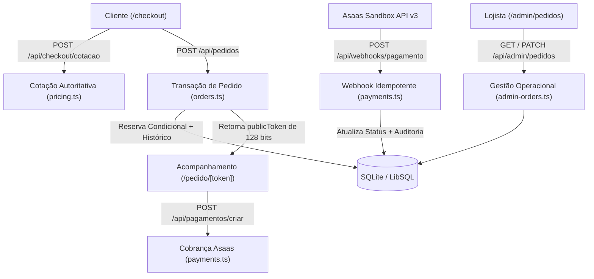
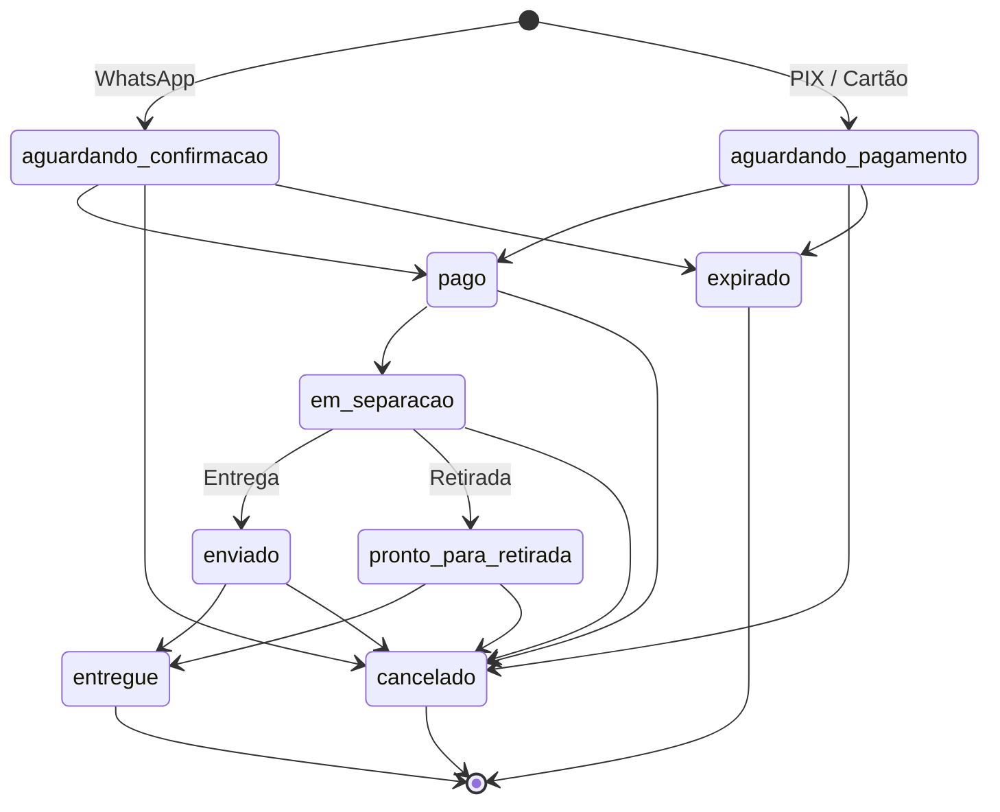

# Arquitetura do checkout, pagamentos e gestão de pedidos

Esta documentação descreve a implementação do fluxo de checkout, precificação em centavos inteiros, reserva transacional de estoque, integração com o gateway Asaas (Sandbox), acompanhamento público de pedidos e painel operacional da Mariane Cosméticos.

## Visão geral da arquitetura

O subsistema de pedidos e pagamentos divide-se em quatro camadas:

1. Configuração compartilhada (`src/config/store.ts` e `src/config/commerce.ts`): constantes cadastrais da loja física em Lages (SC), parâmetros comerciais em centavos inteiros, flags de métodos de pagamento e gerador único de mensagens para o WhatsApp.
2. Domínio e persistência (`src/lib/` e `src/db/schema.ts`): motor financeiro (`pricing.ts`), criação transacional e mascaramento LGPD (`orders.ts`), máquina de estados (`order-state-machine.ts`), integração Asaas e webhooks (`payments.ts`, `payment-urls.ts`), autenticação administrativa (`admin-auth.ts`), consulta paginada (`admin-orders.ts`), controle de taxa de requisições (`rate-limit.ts`) e erros HTTP padronizados pela RFC 7807 (`api-errors.ts`).
3. Rotas de API (`src/app/api/`): endpoints REST para cotação autoritativa, criação de pedido, consulta por token público, geração de cobrança Sandbox, recepção de webhooks e administração de pedidos.
4. Interfaces de usuário (`src/app/checkout/`, `src/app/pedido/[token]/` e `src/app/admin/`): componentes React 19 e Next.js 15 App Router para finalização de compra, página de acompanhamento pelo cliente e painel operacional da lojista.



## Configuração compartilhada (`src/config/`)

Os arquivos em `src/config/` centralizam os dados da marca e as regras numéricas do comércio eletrônico para evitar valores fixos espalhados entre cliente e servidor:

- [`src/config/store.ts`](file:///c:/Projetos/Mariane%20Cosmeticos/src/config/store.ts): exporta `STORE_CONFIG` com razão social (`Mariane Cosméticos e Perfumaria Ltda`), nome fantasia (`Mariane Cosméticos`), slogan (`Linda é a mulher que bem se quer`), credencial (`Revendedora Oficial Madressenza`), domínio canônico (`https://marianecosmeticos.com.br`), contatos (`5549991251617` e `@mariane_cosmeticos_01`) e endereço da loja física (`Rua Blumenau, Nº 623`, bairro São Cristóvão, Lages, SC, CEP `88505-300`, com retirada de segunda a sexta das 09h às 18h e sábado das 09h às 13h). O módulo também exporta `buildOrderWhatsAppMessage` e `buildWhatsAppLink`, responsáveis por montar o texto do pedido em reais a partir dos valores em centavos e anexar o link de acompanhamento `/pedido/<publicToken>`.
- [`src/config/commerce.ts`](file:///c:/Projetos/Mariane%20Cosmeticos/src/config/commerce.ts): exporta `COMMERCE_CONFIG` com todos os valores monetários em centavos inteiros:
  - `SHIPPING_FIXED_CENTS`: `2290` (R$ 22,90)
  - `FREE_SHIPPING_THRESHOLD_CENTS`: `19900` (R$ 199,00)
  - `DEFAULT_PIX_DISCOUNT_PERCENT`: `5` (5%)
  - `MAX_INSTALLMENTS`: `10`
  - `MIN_INSTALLMENT_VALUE_CENTS`: `2000` (R$ 20,00)
  - `ORDER_EXPIRATION_HOURS`: `24` (24 horas para expiração de pedidos pendentes)
  - `MAX_ITEMS_PER_ORDER`: `50`
  - `MAX_QUANTITY_PER_ITEM`: `20`
  - `PAYMENT_FEATURES`: habilita `whatsapp` por padrão e ativa `pixAsaas` ou `cardAsaas` quando `ASAAS_API_KEY` e as flags `NEXT_PUBLIC_ENABLE_PIX` ou `NEXT_PUBLIC_ENABLE_CARD` estão definidas como `"true"`.

## Motor financeiro em centavos inteiros (`src/lib/pricing.ts`)

Conforme registrado no [ADR 0001](file:///c:/Projetos/Mariane%20Cosmeticos/docs/adr/0001-integer-cents-with-expand-migrate-contract.md), todos os cálculos de subtotal, desconto, frete e total ocorrem em centavos inteiros (`integer`) para eliminar erros de representação em ponto flutuante IEEE 754.

Funções exportadas por [`src/lib/pricing.ts`](file:///c:/Projetos/Mariane%20Cosmeticos/src/lib/pricing.ts):

- `toCents(reais)`: converte valores decimais legados para centavos inteiros via `Math.round(reais * 100)`.
- `toReais(cents)`: divide os centavos por `100` para retrocompatibilidade com colunas legadas (`real`) e payloads externos.
- `formatBrl(cents)`: formata centavos inteiros no padrão monetário `pt-BR` (`R$`).
- `calculateItemPriceCents(item)`: retorna `promoPriceCents` somente quando `promoPriceCents > 0` e `promoPriceCents < priceCents`; caso contrário, utiliza `priceCents`.
- `calculateShippingCents(subtotalCents, deliveryMode)`: retorna `0` quando `deliveryMode === "retirada"` ou quando `subtotalCents >= 19900`; nos demais casos de entrega domiciliar, retorna `2290`.
- `calculatePixDiscountCents(items)`: calcula o desconto item a item aplicando `Math.round((lineTotal * percent) / 100)`, onde `percent` respeita `products.pixDiscountPercent` cadastrado no banco (ou `5%` quando ausente).
- `calculateOrderPricing(input)`: consolida `subtotalCents`, `shippingCents`, `discountCents` (aplicado quando `paymentMethod === "pix"`), `totalCents` (`Math.max(0, subtotalCents - discountCents + shippingCents)`), `freeShippingThresholdCents` e `freeShippingRemainingCents`.

O endpoint `POST /api/checkout/cotacao` ([`src/app/api/checkout/cotacao/route.ts`](file:///c:/Projetos/Mariane%20Cosmeticos/src/app/api/checkout/cotacao/route.ts)) valida o payload com `quoteRequestSchema`, consolida itens duplicados do mesmo produto, busca os preços vigentes no banco de dados e retorna o objeto `OrderPricingSummary`. A rota aplica limite de 30 requisições por minuto por IP.

## Modelo de dados e migração expand-migrate-contract (`src/db/schema.ts`)

A evolução do esquema em [`src/db/schema.ts`](file:///c:/Projetos/Mariane%20Cosmeticos/src/db/schema.ts) segue o padrão expand, migrate e contract para manter compatibilidade com os testes e dados legados:

- `products`: preserva `price` e `promo_price` (`REAL`) e adiciona `price_cents` e `promo_price_cents` (`INTEGER`). Os gatilhos `trg_products_stock_non_negative_insert` e `trg_products_stock_non_negative_update` abortam qualquer operação que resulte em `stock < 0`.
- `orders`: preserva `id` (`MC-YYYYMMDD-XXXXXX`) e `total` (`REAL`), adicionando `public_token` (`TEXT`, índice único `idx_orders_public_token`), `idempotency_key` (`TEXT`, índice único `idx_orders_idempotency_key`), `subtotal_cents`, `shipping_cents`, `discount_cents`, `total_cents`, `delivery_mode` (`'entrega' | 'retirada'`), `marketing_consent` (`0 | 1`) e `expires_at` (`TEXT`). Possui índice composto `idx_orders_status_created` em `(status, created_at)`.
- `order_items`: preserva `unit_price` (`REAL`) e adiciona `unit_price_cents`, `line_total_cents` (`INTEGER`) e o índice `idx_order_items_order_id`.
- `order_status_history`: registra cada mudança de estado com `id`, `order_id` (`ON DELETE CASCADE`), `from_status`, `to_status`, `actor` (`customer`, `admin`, `webhook_asaas`, `asaas_sync_on_read` ou `system_expiration`), `notes` e `created_at`.
- `payment_webhooks`: garante idempotência no processamento de eventos do provedor de pagamento por meio da chave primária `event_id`.

Os artefatos de migração ficam em [`drizzle/0001_checkout_expansion.sql`](file:///c:/Projetos/Mariane%20Cosmeticos/drizzle/0001_checkout_expansion.sql) (subida com backfill idempotente), [`drizzle/0001_checkout_expansion.down.sql`](file:///c:/Projetos/Mariane%20Cosmeticos/drizzle/0001_checkout_expansion.down.sql) (reversão da fase Expand) e [`src/scripts/migrate-checkout-expansion.ts`](file:///c:/Projetos/Mariane%20Cosmeticos/src/scripts/migrate-checkout-expansion.ts) (execução programática via `@libsql/client`).

## Criação transacional, reserva de estoque e idempotência (`src/lib/orders.ts`)

A função `createOrderTransaction` em [`src/lib/orders.ts`](file:///c:/Projetos/Mariane%20Cosmeticos/src/lib/orders.ts) coordena a validação, a reserva de estoque e a persistência do pedido:

1. Validação de entrada: executa `createOrderSchema.safeParse` ([`src/lib/validations/checkout.ts`](file:///c:/Projetos/Mariane%20Cosmeticos/src/lib/validations/checkout.ts)), que remove caracteres `<` e `>`, exige telefone com 10 ou 11 dígitos, valida o campo anti-spam `honeypot` (`max(0)`), exige `idempotencyKey` entre 16 e 64 caracteres e, quando `deliveryMode === "entrega"`, requer `cep` de 8 dígitos, `address` e `city`. O campo `marketingConsent` tem valor padrão `false` ([ADR 0004](file:///c:/Projetos/Mariane%20Cosmeticos/docs/adr/0004-lgpd-contractual-execution-vs-granular-marketing-consent.md)).
2. Verificação de idempotência e posse: consulta `orders.idempotencyKey` antes e dentro da transação (com captura adicional de `SQLITE_CONSTRAINT_UNIQUE`). Se a chave já existir para os mesmos parâmetros do cliente, retorna a projeção higienizada com `customerPhone` mascarado, `whatsappUrl` e `idempotent: true` (HTTP `200`). Caso a chave pertença a outro pedido divergente, retorna HTTP `409 Conflict`.
3. Ordenação determinística e serialização de escrita: consolida itens repetidos, verifica se nenhuma quantidade somada excede `MAX_QUANTITY_PER_ITEM` (20) e ordena a lista por `productId`. A transação roda encapsulada em `withSqliteWriteLock`, que serializa a promoção de locks de escrita no processo Node.js e aplica até 3 tentativas com recuo exponencial curto em caso de `SQLITE_BUSY`.
4. Reserva condicional de estoque ([ADR 0003](file:///c:/Projetos/Mariane%20Cosmeticos/docs/adr/0003-atomic-stock-reservation-and-lazy-expiration.md)): para cada item, executa:
   ```sql
   UPDATE products
   SET stock = stock - :quantity
   WHERE id = :productId AND stock >= :quantity
   ```
   Se `rowsAffected === 0`, lança `OutOfStockError`, desfaz toda a transação (rollback) e responde com HTTP `409 Conflict` no formato RFC 7807.
5. Duplo identificador ([ADR 0002](file:///c:/Projetos/Mariane%20Cosmeticos/docs/adr/0002-dual-order-identifiers-human-code-vs-public-token.md)):
   - `id` (`generateOrderHumanCode`): formato `MC-YYYYMMDD-XXXXXX` com 6 caracteres hexadecimais gerados por `crypto.randomBytes(4)` ($16^6 = 16.777.216$ combinações por dia), usado na comunicação com a lojista.
   - `publicToken` (`generatePublicToken`): UUID v4 de 128 bits (`crypto.randomUUID()`), usado na URL pública `/pedido/[token]`.
6. Persistência em lote e auditoria inicial: insere o pedido em `orders` com prazo de expiração de 24 horas (`expiresAt`), grava todos os itens em lote único em `order_items` e registra a entrada inicial em `order_status_history` com `actor: "customer"`. O status inicial é `"aguardando_confirmacao"` para pedidos via WhatsApp e `"aguardando_pagamento"` para PIX ou cartão.

A rota `POST /api/pedidos` ([`src/app/api/pedidos/route.ts`](file:///c:/Projetos/Mariane%20Cosmeticos/src/app/api/pedidos/route.ts)) aplica limite de 5 criações de pedido por IP a cada 10 minutos. A rota `GET /api/pedidos` retorna HTTP `400` informando a descontinuação da busca por código curto para prevenir enumeração de pedidos (IDOR).

## Máquina de estados monotônica e histórico (`src/lib/order-state-machine.ts`)

O ciclo de vida do pedido é controlado por [`src/lib/order-state-machine.ts`](file:///c:/Projetos/Mariane%20Cosmeticos/src/lib/order-state-machine.ts), que define 9 estados e a matriz de transições permitidas (`ALLOWED_STATUS_TRANSITIONS`):

| Estado de origem | Estados de destino permitidos | Estado terminal | Repõe estoque |
| :--- | :--- | :--- | :--- |
| `aguardando_confirmacao` | `pago`, `cancelado`, `expirado` | Não | Não |
| `aguardando_pagamento` | `pago`, `cancelado`, `expirado` | Não | Não |
| `pago` | `em_separacao`, `cancelado` | Não | Não |
| `em_separacao` | `enviado`, `pronto_para_retirada`, `cancelado` | Não | Não |
| `enviado` | `entregue`, `cancelado` | Não | Não |
| `pronto_para_retirada` | `entregue`, `cancelado` | Não | Não |
| `entregue` | Nenhum | Sim | Não |
| `cancelado` | Nenhum | Sim | Sim |
| `expirado` | Nenhum | Sim | Sim |



A função `changeOrderStatus(orderId, newStatus, actor, notes)` em [`src/lib/orders.ts`](file:///c:/Projetos/Mariane%20Cosmeticos/src/lib/orders.ts) valida a transição via `validateTransition(currentStatus, newStatus)`. Se a transição não for permitida, lança `InvalidStatusTransitionError`. Quando válida, atualiza `orders.status` condicionada ao status anterior (`WHERE id = :id AND status = :rawStatus`), devolve as quantidades de `order_items` para `products.stock` caso `isRestockStatus(newStatus)` seja verdadeiro (`cancelado` ou `expirado`) e grava a mudança em `order_status_history`.

## Integração Asaas Sandbox e webhook idempotente (`src/lib/payments.ts` e `src/lib/payment-urls.ts`)

### Validação de URLs e proteção contra Open Redirect (`src/lib/payment-urls.ts`)

O módulo [`src/lib/payment-urls.ts`](file:///c:/Projetos/Mariane%20Cosmeticos/src/lib/payment-urls.ts) implementa três validadores:

- `isValidPublicToken(token)`: verifica se o token corresponde a um identificador hexadecimal/UUID de 128 bits.
- `validateReturnUrl(rawUrl)`: aceita apenas caminhos relativos `/pedido/<token-128-bits>` ou URLs absolutas dos domínios `https://marianecosmeticos.com.br` e `http://localhost:3001` que apontem exatamente para `/pedido/<token-128-bits>`, sem credenciais, query strings, fragmentos, barras invertidas ou barras duplas (`//`).
- `validateAsaasCheckoutUrl(rawUrl)`: exige protocolo `https:`, porta padrão, ausência de credenciais ou parâmetros extras, hostname pertencente a `sandbox.asaas.com`, `www.asaas.com` ou `asaas.com` e caminho no formato `/i/<id>` ou `/c/<id>`.

### Criação de cobrança Sandbox (`createSandboxPayment`)

Acionada por `POST /api/pagamentos/criar` ([`src/app/api/pagamentos/criar/route.ts`](file:///c:/Projetos/Mariane%20Cosmeticos/src/app/api/pagamentos/criar/route.ts), limitada a 15 requisições por 10 minutos por IP) e pela página `/pedido/[token]`:

1. Verifica se o pedido existe, está pendente (`aguardando_pagamento` ou `aguardando_confirmacao`), dentro da janela de 24 horas (`expiresAt`) e se a modalidade solicitada (`pix` ou `card`) é compatível com o método escolhido no pedido (bloqueando pagamento por cartão em pedidos emitidos com desconto PIX).
2. Valida `returnUrl` via `validateReturnUrl` (retornando HTTP `400` se malformada ou externa) e compara o token da URL com `order.publicToken` (retornando HTTP `403` em caso de divergência, o que impede referência direta insegura entre pedidos).
3. Quando o modo Sandbox de homologação não está ativo, retorna HTTP `200` com `sandboxConfigured: false`, preservando o pedido para conclusão via WhatsApp.
4. Quando o modo Sandbox está ativo em ambiente de homologação, gera `paymentId`, payload PIX Copia e Cola, QR Code SVG/Base64 com o valor em centavos do pedido e `checkoutUrl` validada por `validateAsaasCheckoutUrl`.

### Sincronização ativa na leitura (`syncOrderPaymentStatusFromProvider`)

Ao abrir `/pedido/[token]` para um pedido pendente, o servidor executa `syncOrderPaymentStatusFromProvider(order.id)` antes de avaliar a expiração de 24 horas. Se `ASAAS_API_KEY` estiver configurada, consulta `GET /payments?externalReference=<orderId>&limit=1` na API v3 do Asaas com timeout de 3,5 segundos (`AbortController`). Se o provedor retornar status `CONFIRMED` ou `RECEIVED` e `toCents(payment.value) === expectedTotalCents`, o pedido avança para `pago` dentro de uma transação com `actor: "asaas_sync_on_read"`.

### Processamento de webhook (`handlePaymentWebhook`)

A rota `POST /api/webhooks/pagamento` ([`src/app/api/webhooks/pagamento/route.ts`](file:///c:/Projetos/Mariane%20Cosmeticos/src/app/api/webhooks/pagamento/route.ts)) delega a `handlePaymentWebhook` em [`src/lib/payments.ts`](file:///c:/Projetos/Mariane%20Cosmeticos/src/lib/payments.ts):

1. Autenticação em tempo constante (`verifyWebhookSignature`): valida o cabeçalho `x-webhook-signature` (HMAC-SHA256 do corpo bruto) ou `asaas-access-token` / `x-asaas-access-token` contra o segredo configurado (`ASAAS_WEBHOOK_TOKEN`, `ASAAS_WEBHOOK_SECRET` ou `PAYMENT_WEBHOOK_SECRET`), comparando os hashes SHA-256 via `crypto.timingSafeEqual` e verificando a igualdade de comprimento. Requisições sem assinatura válida recebem HTTP `401`.
2. Validação financeira em centavos inteiros: para eventos `PAYMENT_RECEIVED` e `PAYMENT_CONFIRMED`, exige `typeof parsed.payment?.value === "number"` e `toCents(parsed.payment.value) === expectedTotalCents`, além de validar compatibilidade de `billingType` para pedidos com desconto PIX. Qualquer divergência retorna HTTP `400`.
3. Idempotência (`payment_webhooks`): verifica se `eventId` (`parsed.id` ou `parsed.eventId`) já consta na tabela `payment_webhooks`. Eventos repetidos retornam HTTP `200` com `idempotentReplay: true` sem alterar o pedido nem o estoque.
4. Tratamento de pagamento tardio em pedido expirado: se o pedido já estiver como `expirado` e receber `PAYMENT_RECEIVED` ou `PAYMENT_CONFIRMED`, o sistema mantém o status `expirado`, grava o evento em `payment_webhooks`, registra um alerta em `order_status_history` (`ALERTA: Pagamento confirmado após expiração. Necessária ação manual da lojista para reativar ou estornar`) e retorna HTTP `200` com `expiredOrderAlert: true`.
5. Transição e estorno de estoque:
   - `PAYMENT_RECEIVED` e `PAYMENT_CONFIRMED`: avançam o status para `pago`.
   - `PAYMENT_REFUNDED` e `PAYMENT_CHARGEBACK_REQUESTED`: avançam para `cancelado` e devolvem os itens ao estoque.
   - `PAYMENT_OVERDUE` e `PAYMENT_DELETED`: avançam para `expirado` e devolvem os itens ao estoque.

## Página de acompanhamento `/pedido/[token]` e proteção de dados (LGPD)

A página [`src/app/pedido/[token]/page.tsx`](file:///c:/Projetos/Mariane%20Cosmeticos/src/app/pedido/%5Btoken%5D/page.tsx) e o endpoint `GET /api/pedidos/[token]` ([`src/app/api/pedidos/[token]/route.ts`](file:///c:/Projetos/Mariane%20Cosmeticos/src/app/api/pedidos/%5Btoken%5D/route.ts)) consultam o pedido exclusivamente pelo `publicToken` de 128 bits via `getOrderByPublicToken`.

### Expiração preguiçosa (Lazy Expiration)

Quando `getOrderByPublicToken` lê um pedido com status `aguardando_confirmacao` ou `aguardando_pagamento` cujo `expiresAt` já passou, a função aciona `changeOrderStatus(order.id, "expirado", "system_expiration", ...)` antes de retornar os dados, devolvendo o estoque reservado.

### Mascaramento de dados pessoais (PII)

Para cumprir o princípio da minimização de dados (Art. 6º, III da LGPD) em uma URL compartilhável, as funções de mascaramento de PII definidas em [`src/lib/orders.ts`](file:///c:/Projetos/Mariane%20Cosmeticos/src/lib/orders.ts) transformam os dados antes da serialização pública:

- `maskPiiName(fullName)`: mantém o primeiro nome e a inicial do último sobrenome seguida de asteriscos (ex.: `"Maria Luiza Silva"` torna-se `"Maria S***"`).
- `maskPiiPhone(phone)`: preserva apenas os 4 dígitos finais (ex.: `"(***) *****-1617"`).
- `maskPiiEmail(email)`: preserva o primeiro e o último caractere do usuário e o domínio (ex.: `"m***a@dominio.com"`).
- `maskPiiAddress(address, deliveryMode)`: exibe o endereço completo da loja física quando `deliveryMode === "retirada"`; para entregas residenciais, oculta rua, número e complemento, mantendo apenas o rótulo `"Endereço residencial protegido"`, a cidade e os 5 primeiros dígitos do CEP (`88505-***`).

Além do mascaramento, a página `/pedido/[token]` define `robots: { index: false, follow: false }` em `generateMetadata` e renderiza os componentes [`OrderStatusTimeline.tsx`](file:///c:/Projetos/Mariane%20Cosmeticos/src/app/pedido/%5Btoken%5D/components/OrderStatusTimeline.tsx), [`OrderNextSteps.tsx`](file:///c:/Projetos/Mariane%20Cosmeticos/src/app/pedido/%5Btoken%5D/components/OrderNextSteps.tsx), [`PixPaymentAction.tsx`](file:///c:/Projetos/Mariane%20Cosmeticos/src/app/pedido/%5Btoken%5D/components/PixPaymentAction.tsx), [`CardPaymentAction.tsx`](file:///c:/Projetos/Mariane%20Cosmeticos/src/app/pedido/%5Btoken%5D/components/CardPaymentAction.tsx) e [`OrderSummaryCard.tsx`](file:///c:/Projetos/Mariane%20Cosmeticos/src/app/pedido/%5Btoken%5D/components/OrderSummaryCard.tsx).

## Painel operacional `/admin/login` e `/admin/pedidos`

O painel da lojista permite consultar pedidos com dados completos para expedição, filtrar por status ou busca textual, avançar estados do pedido, acionar o cliente via WhatsApp e exportar relatórios em CSV.

### Autenticação, sessão e proteção CSRF (`src/lib/admin-auth.ts` e `src/middleware.ts`)

- Validação de senha (`verifyAdminPassword`): compara a senha enviada com `process.env.ADMIN_PASSWORD` aplicando hash SHA-256 em ambos os lados e `crypto.timingSafeEqual`.
- Token de sessão (`createAdminSessionToken` e `verifyAdminSessionToken`): gera um token assinado no formato `<expiresAt>.<hmac_sha256("admin:" + expiresAt, ADMIN_PASSWORD)>` com validade de 12 horas (`ADMIN_SESSION_TTL_MS`). O cookie `admin_session` é gravado com `HttpOnly`, `SameSite=Lax`, `Path=/` e `Secure` em produção.
- Proteção de borda ([`src/middleware.ts`](file:///c:/Projetos/Mariane%20Cosmeticos/src/middleware.ts)): intercepta `/admin/:path*` e `/api/admin/:path*` (exceto `/admin/login` e `/api/admin/auth`) validando a assinatura HMAC-SHA256 via Web Crypto API (`crypto.subtle`). Requisições não autenticadas para `/api/admin/*` recebem HTTP `401` (`application/problem+json`), enquanto acessos a páginas `/admin/*` são redirecionados para `/admin/login`.
- Proteção CSRF e controle de força bruta ([`src/app/api/admin/auth/route.ts`](file:///c:/Projetos/Mariane%20Cosmeticos/src/app/api/admin/auth/route.ts)): mutações administrativas (`POST /api/admin/auth`, `DELETE /api/admin/auth` e `PATCH /api/admin/pedidos/[id]/status`) verificam `Origin` e `Sec-Fetch-Site` com `verifyAdminCsrfOrigin`. O login administrativo permite no máximo 5 tentativas a cada 15 minutos por IP (com trava global complementar contra spoofing).

### Listagem, busca segura e expiração em lote (`src/lib/admin-orders.ts`)

A função `queryAdminOrders` em [`src/lib/admin-orders.ts`](file:///c:/Projetos/Mariane%20Cosmeticos/src/lib/admin-orders.ts), consumida por `GET /api/admin/pedidos` ([`src/app/api/admin/pedidos/route.ts`](file:///c:/Projetos/Mariane%20Cosmeticos/src/app/api/admin/pedidos/route.ts)):

1. Executa `sweepExpiredPendingOrders` em uma transação única para até 50 pedidos pendentes cujo `expiresAt` já venceu, transicionando-os para `expirado` e devolvendo o estoque.
2. Aplica paginação limitada (`1 <= limit <= 100`, padrão `20` na API e `10` na interface `/admin/pedidos`).
3. Escapa curingas SQL (`%`, `_` e `\`) via `escapeLikePattern` com cláusula `ESCAPE '\'` ao buscar por código `MC-...`, nome da cliente ou telefone (incluindo busca por dígitos sem pontuação).

### Atualização de status e exportação CSV segura

- `PATCH /api/admin/pedidos/[id]/status` ([`src/app/api/admin/pedidos/[id]/status/route.ts`](file:///c:/Projetos/Mariane%20Cosmeticos/src/app/api/admin/pedidos/%5Bid%5D/status/route.ts)): recebe `{ status, notes }`, valida se o status pertence a `ORDER_STATUS_LABELS` e chama `changeOrderStatus(id, nextStatus, "admin", notes)`. Tentativas de transição inválida retornam HTTP `409 Conflict` com detalhes do erro.
- `GET /api/admin/pedidos/export-csv` ([`src/app/api/admin/pedidos/export-csv/route.ts`](file:///c:/Projetos/Mariane%20Cosmeticos/src/app/api/admin/pedidos/export-csv/route.ts)): exporta até 500 pedidos ordenados por data de criação decrescente. A função `sanitizeCsvCell` em [`src/lib/admin-auth.ts`](file:///c:/Projetos/Mariane%20Cosmeticos/src/lib/admin-auth.ts) neutraliza ataques de CSV Injection (Formula Injection) prefixando com apóstrofo (`'`) qualquer célula que comece com `=`, `+`, `-`, `@`, `|`, `\t`, `\r` ou `\n` (mesmo após espaços iniciais), removendo quebras de linha internas e escapando aspas duplas.

## Referência de rotas e limites de taxa (Rate Limiting)

| Rota | Método | Autenticação | Rate Limit | Descrição |
| :--- | :--- | :--- | :--- | :--- |
| `/checkout` | `GET` | Pública | N/A | Página de finalização de compra em 3 etapas com cotação em tempo real e consulta ViaCEP (timeout de 4s). |
| `/pedido/[token]` | `GET` | Token 128 bits | N/A | Página de acompanhamento do pedido com dados mascarados (LGPD), QR Code PIX, link Asaas e botão WhatsApp. |
| `/admin/login` | `GET` | Pública | N/A | Tela de login operacional da lojista. |
| `/admin/pedidos` | `GET` | Cookie `admin_session` | N/A | Painel operacional de pedidos com filtros por status, busca com debounce, atualização de estado e exportação CSV. |
| `/api/checkout/cotacao` | `POST` | Pública | 30 req / 1 min por IP | Calcula subtotal, desconto PIX, frete e total em centavos inteiros a partir do banco. |
| `/api/pedidos` | `POST` | Pública | 5 req / 10 min por IP | Cria o pedido em transação atômica com reserva condicional de estoque e chave de idempotência. |
| `/api/pedidos/[token]` | `GET` | Token 128 bits | 60 req / 1 min por IP | Retorna os dados do pedido com PII mascarada e histórico de status. |
| `/api/pagamentos/criar` | `POST` | Pública (valida posse do token) | 15 req / 10 min por IP | Gera cobrança PIX ou Cartão no Asaas Sandbox validando `returnUrl` e `checkoutUrl`. |
| `/api/webhooks/pagamento` | `POST` | HMAC-SHA256 ou `asaas-access-token` | N/A | Processa eventos de cobrança do Asaas com verificação de centavos e idempotência em `payment_webhooks`. |
| `/api/admin/auth` | `POST` / `DELETE` | Senha (`POST`) / Cookie (`DELETE`) + CSRF Origin | 5 req / 15 min por IP (`POST`) | Autentica a lojista emitindo cookie `HttpOnly` de 12h ou encerra a sessão administrativa. |
| `/api/admin/pedidos` | `GET` | Cookie `admin_session` | N/A | Lista pedidos paginados com itens, histórico e limpeza automática de pendentes expirados. |
| `/api/admin/pedidos/[id]/status` | `PATCH` | Cookie `admin_session` + CSRF Origin | N/A | Executa transição de status na máquina de estados monotônica e repõe estoque em cancelamentos. |
| `/api/admin/pedidos/export-csv` | `GET` | Cookie `admin_session` | N/A | Exporta os pedidos em arquivo CSV com sanitização contra injeção de fórmulas. |

## Decisões arquiteturais relacionadas (ADRs)

- [ADR 0001: Valores monetários em centavos inteiros com migração expand-migrate-contract](file:///c:/Projetos/Mariane%20Cosmeticos/docs/adr/0001-integer-cents-with-expand-migrate-contract.md)
- [ADR 0002: Duplo identificador de pedido (código humano curto vs. token público de 128 bits)](file:///c:/Projetos/Mariane%20Cosmeticos/docs/adr/0002-dual-order-identifiers-human-code-vs-public-token.md)
- [ADR 0003: Reserva atômica condicional de estoque e expiração preguiçosa](file:///c:/Projetos/Mariane%20Cosmeticos/docs/adr/0003-atomic-stock-reservation-and-lazy-expiration.md)
- [ADR 0004: Base legal LGPD de execução de contrato vs. consentimento granular de marketing](file:///c:/Projetos/Mariane%20Cosmeticos/docs/adr/0004-lgpd-contractual-execution-vs-granular-marketing-consent.md)
