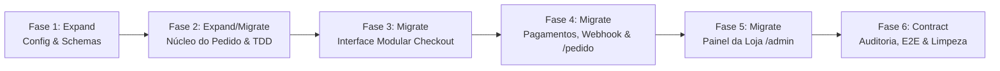

# Plano de Implementação: Redesenho do Checkout e Pedidos (MVP)
**Projeto:** Mariane Cosméticos  
**Especificação de Referência:** `docs/checkout/ESPECIFICACAO.md`  
**Estratégia de Banco:** *Expand → Migrate → Contract* (zero-downtime, dados legados preservados)  
**Metodologia:** Test-Driven Development (TDD) com testes unitários, integração e E2E  

---

## Visão Geral das Fases

---

## Fase 1: Expand — Configurações, Módulo de Preços & Esquemas de Banco

O objetivo desta fase é criar a fundação tipada em centavos inteiros e expandir o esquema do banco sem quebrar as colunas legadas existentes.

### Tarefa 1.1: Configurações Únicas da Loja, Comércio e PRAGMAs do LibSQL
- **Arquivos:**
  - Modificar: `package.json` (adicionar `zod`)
  - Modificar: `src/db/index.ts` (PRAGMAs WAL, busy_timeout, foreign_keys)
  - Criar: `src/config/store.ts`
  - Criar: `src/config/commerce.ts`
  - Criar: `src/lib/api-errors.ts` (helper RFC 9457 `createProblemDetailsResponse`)
  - Criar: `tests/unit/config.test.ts`
- **Ações:**
  1. Instalar dependência essencial de validação: `npm install zod`.
  2. Configurar PRAGMAs vitais em `src/db/index.ts` (`WAL`, `busy_timeout = 5000`, `foreign_keys = ON`, `synchronous = NORMAL`).
  3. Escrever teste em `tests/unit/config.test.ts` verificando constantes e a função pura `buildOrderWhatsAppMessage`.
  4. Implementar `src/config/store.ts` com dados oficiais da Mariane Cosméticos (conforme `docs/DESIGN.md` e `ESPECIFICACAO.md`).
  5. Implementar `src/config/commerce.ts` com valores estritamente em centavos inteiros (`SHIPPING_FIXED_CENTS = 2290`, `FREE_SHIPPING_THRESHOLD_CENTS = 19900`, `ORDER_EXPIRATION_HOURS = 24`).
  6. Implementar `src/lib/api-errors.ts` padronizando respostas RFC 9457 em português.
- **Critério de Sucesso:** Testes passam com `npx tsx tests/unit/config.test.ts`.

### Tarefa 1.2: Módulo de Preços Puro em Centavos (TDD)
- **Arquivos:**
  - Criar: `src/lib/pricing.ts`
  - Criar: `tests/unit/pricing.test.ts`
- **Ações:**
  1. Escrever testes cobrindo:
     - Conversão de reais para centavos e vice-versa sem resíduos flutuantes.
     - Frete fixo (R$ 22,90 = 2290 centavos).
     - Frete grátis no valor exato do limite (R$ 199,00 = 19900 centavos -> frete 0).
     - Frete em retirada na loja física -> sempre 0.
     - Desconto PIX respeitando `pixDiscountPercent` por produto e fallback de 5%.
     - Arredondamento monetário de centavos por item.
  2. Implementar funções puras em `src/lib/pricing.ts` (`toCents`, `toReais`, `formatBrl`, `calculateShipping`, `calculatePixDiscount`, `calculateOrderPricing`).
- **Critério de Sucesso:** Todos os casos de teste de preços passam com 100% de cobertura.

### Tarefa 1.3: Expansão do Schema Drizzle com Índices e Migração Segura
- **Arquivos:**
  - Modificar: `src/db/schema.ts`
  - Criar: `drizzle/0001_checkout_expansion.sql`
  - Criar: `tests/unit/schema-expand.test.ts`
- **Ações:**
  1. Adicionar colunas novas em `products` mantendo as legadas:
     - `priceCents`: `integer("price_cents")`
     - `promoPriceCents`: `integer("promo_price_cents")`
  2. Adicionar colunas novas em `orders` mantendo as legadas (com `publicToken` inicialmente opcional para compatibilidade no SQLite):
     - `publicToken`: `text("public_token")`
     - `idempotencyKey`: `text("idempotency_key").unique()`
     - `subtotalCents`: `integer("subtotal_cents")`
     - `shippingCents`: `integer("shipping_cents")`
     - `discountCents`: `integer("discount_cents")`
     - `totalCents`: `integer("total_cents")`
     - `deliveryMode`: `text("delivery_mode").default("entrega")`
     - `marketingConsent`: `integer("marketing_consent").default(0)`
     - `expiresAt`: `text("expires_at")`
  3. Adicionar colunas novas em `order_items`:
     - `unitPriceCents`: `integer("unit_price_cents")`
     - `lineTotalCents`: `integer("line_total_cents")`
  4. Criar nova tabela `order_status_history` com onDelete: "cascade" e índices:
     - `id`, `orderId`, `fromStatus`, `toStatus`, `actor`, `notes`, `createdAt`.
  5. Adicionar índices vitais:
     - `idx_order_items_order_id` em `order_items(order_id)`
     - `idx_order_status_history_order_created` em `order_status_history(order_id, created_at)`
     - `idx_orders_status_created` em `orders(status, created_at)`
     - `idx_orders_public_token` (único) em `orders(public_token)`
  6. Gerar e executar migração SQL versionada com backfill para pedidos legados (`lower(hex(randomblob(16)))`) e produtos legados (`ROUND(price * 100)`).
- **Critério de Sucesso:** Banco local aceita dados no formato expandido sem afetar leituras de pedidos antigos e com índices ativos.

---

## Fase 2: Expand & Migrate — Núcleo Transacional do Pedido & API

### Tarefa 2.1: Máquina de Estados Monotônica e Histórico
- **Arquivos:**
  - Criar: `src/lib/order-state-machine.ts`
  - Criar: `tests/unit/order-state-machine.test.ts`
- **Ações:**
  1. Escrever testes cobrindo todas as transições válidas e inválidas (ex: impedir transição de `cancelado` para `pago`, permitir `aguardando_confirmacao` -> `pago`).
  2. Implementar validação da máquina de estados com matriz `ALLOWED_STATUS_TRANSITIONS`.
  3. Implementar função de transição com gravação atômica em `order_status_history` e liberação de estoque em `cancelado` ou `expirado` (apenas se `rowsAffected > 0` para impedir duplo estorno).
- **Critério de Sucesso:** Testes unitários da máquina de estados com 100% de sucesso.

### Tarefa 2.2: Contrato Único de Entrada e Cotação Segura
- **Arquivos:**
  - Criar: `src/lib/validations/checkout.ts`
  - Criar: `src/app/api/checkout/cotacao/route.ts`
  - Criar: `tests/unit/checkout-validation.test.ts`
- **Ações:**
  1. Implementar schema de validação com Zod: `{ customerName, customerPhone, deliveryMode, cep, address, city, paymentMethod, items, idempotencyKey, honeypot }`.
  2. Implementar endpoint `POST /api/checkout/cotacao` que calcula os valores oficiais em centavos a partir do banco e do `pricing.ts`.
  3. Garantir respostas de erro em conformidade com o formato RFC 9457 em português via `createProblemDetailsResponse`.
- **Critério de Sucesso:** Endpoint de cotação rejeita produtos inexistentes e devolve valores exatos em centavos.

### Tarefa 2.3: Criação Transacional de Pedidos com Reserva de Estoque
- **Arquivos:**
  - Modificar: `src/lib/orders.ts`
  - Modificar: `src/app/api/pedidos/route.ts`
  - Criar: `src/app/api/pedidos/[token]/route.ts`
  - Criar: `tests/integration/order-creation.test.ts`
- **Ações:**
  1. Escrever testes de integração:
     - Criação com sucesso congelando preços em centavos e gerando `publicToken`.
     - Idempotência: requisição com a mesma `idempotencyKey` não duplica o pedido nem altera o estoque.
     - Colisão concorrente na `idempotencyKey`: captura exceção de chave duplicada e devolve o pedido existente com HTTP 200.
     - Ordenação determinística de itens agregados por `productId` para eliminar risco de deadlocks.
     - Estoque insuficiente: rejeita e faz rollback de toda a transação.
     - Corrida concorrente: duas compras simultâneas para 1 item em estoque (só a primeira passa).
     - Remoção da consulta pública por código humano (`GET /api/pedidos?id=MC-...` substituído por `GET /api/pedidos/[token]`).
  2. Implementar `createOrderTransaction` em `src/lib/orders.ts` com `db.transaction(async (tx) => { ... })`.
  3. Atualizar rota `POST /api/pedidos` com padrão RFC 9457 e criar `GET /api/pedidos/[token]/route.ts`.
- **Critério de Sucesso:** Todos os testes de concorrência e transação passam via `npx tsx tests/integration/order-creation.test.ts`.

---

## Fase 3: Migrate — Interface Modular do Checkout

### Tarefa 3.1: Decomposição dos Componentes de Checkout
- **Arquivos:**
  - Criar: `src/app/checkout/components/CheckoutContact.tsx`
  - Criar: `src/app/checkout/components/CheckoutDelivery.tsx`
  - Criar: `src/app/checkout/components/CheckoutPayment.tsx`
  - Criar: `src/app/checkout/components/CheckoutSummary.tsx`
  - Criar: `src/app/checkout/components/CheckoutTrustSignals.tsx`
  - Modificar: `src/app/checkout/page.tsx`
- **Ações:**
  1. Quebrar o arquivo monólito de 1.270 linhas em componentes especializados e desacoplados (< 250 linhas cada).
  2. Layout responsivo:
     - Desktop: layout de 3 blocos ordenados com resumo fixo lateral (*sticky*).
     - Mobile: blocos em sequência sanfona, resumo recolhível e barra inferior fixa com total e CTA.
  3. Integrar chamada automática para `/api/checkout/cotacao` ao alterar itens, modalidade de entrega ou meio de pagamento (zero lógica de soma no cliente).
  4. ViaCEP com timeout de 4 segundos (`AbortController`) e liberação imediata de digitação manual em caso de falha.
  5. Campo honeypot invisível e chave de idempotência gerada no carregamento da página via `crypto.randomUUID()`.
  6. LGPD: remover consentimento pré-marcado e exibir checkbox opcional de promoções desmarcado por padrão.
  7. Esvaziamento seguro do carrinho: `clearCart()` executado **exclusivamente após confirmação HTTP 201** da API com o `publicToken`. Em caso de erro de estoque (409) ou rede, os itens permanecem preservados no carrinho do cliente.
  5. Campo honeypot invisível e chave de idempotência gerada no carregamento da página via `crypto.randomUUID()`.
  6. LGPD: remover consentimento pré-marcado e exibir checkbox opcional de promoções.
- **Critério de Sucesso:** Página de checkout modularizada, sem erros de tipagem e com tamanho de componente individual < 250 linhas.

---

## Fase 4: Migrate — Finalização, Pagamentos & Webhook

### Tarefa 4.1: Página de Acompanhamento do Pedido (`/pedido/[token]`)
- **Arquivos:**
  - Criar: `src/app/pedido/[token]/page.tsx`
  - Criar: `src/app/pedido/[token]/components/OrderStatusTimeline.tsx`
  - Criar: `src/app/pedido/[token]/components/PixPaymentAction.tsx`
  - Criar: `src/app/pedido/[token]/components/OrderSummaryCard.tsx`
- **Ações:**
  1. Criar Server Component em `src/app/pedido/[token]/page.tsx` buscando dados por `publicToken`.
  2. Implementar linha do tempo de status conforme a máquina de estados.
  3. Se pagamento for PIX: renderizar QR Code e botão Copia-e-Cola com temporizador regressivo de expiração.
  4. Botão "Falar com a Loja no WhatsApp" gerado exclusivamente pela função `buildOrderWhatsAppMessage`.
  5. Verificação de expiração preguiçosa (*lazy expiration*) ao carregar a página.
- **Critério de Sucesso:** Página carrega instantaneamente no servidor com layout limpo e seguro.

### Tarefa 4.2: Webhook Asaas Rigoroso e Idempotente
- **Arquivos:**
  - Modificar: `src/lib/payments.ts`
  - Modificar: `src/app/api/webhooks/pagamento/route.ts`
  - Criar: `tests/integration/webhook-payment.test.ts`
- **Ações:**
  1. Escrever testes cobrindo:
     - Assinatura HMAC válida e inválida.
     - Idempotência por `eventId` (replay retorna 200 sem efeito colateral).
     - Rejeição de subpagamento (`paidCents !== totalCents`).
     - Transição de status respeitando a máquina de estados (ex: impede rebaixar pedido pago para falho).
     - Corrida com expiração: se o pedido foi marcado como expirado e chega `PAYMENT_CONFIRMED`, registra alerta crítico em `order_status_history` e devolve 200 ao Asaas para triagem manual sem crash.
     - Gravação na trilha `order_status_history`.
  2. Implementar tratamento estrito em `src/lib/payments.ts`.
- **Critério de Sucesso:** Webhook 100% blindado contra subpagamento e ataques de replay via `npx tsx tests/integration/webhook-payment.test.ts`.

---

## Fase 5: Migrate — Painel da Loja (`/admin/pedidos`)

### Tarefa 5.1: Autenticação Segura do Admin
- **Arquivos:**
  - Criar: `src/app/admin/login/page.tsx`
  - Criar: `src/app/api/admin/auth/route.ts`
  - Criar: `src/middleware.ts`
  - Criar: `src/lib/admin-auth.ts`
  - Criar: `tests/unit/admin-auth.test.ts`
- **Ações:**
  1. Implementar autenticação via senha em variável de ambiente `ADMIN_PASSWORD`.
  2. Cookie de sessão `admin_session` assinado com HMAC-SHA256 (`HttpOnly; Secure; SameSite=Lax`).
  3. Rate limit de 5 tentativas por 15 minutos em `/api/admin/auth`.
  4. Middleware protegendo `/admin/*` e `/api/admin/*`.
- **Critério de Sucesso:** Rotas administrativas bloqueadas sem cookie válido.

### Tarefa 5.2: Gestão de Pedidos Mobile-First & Exportação CSV
- **Arquivos:**
  - Criar: `src/app/admin/pedidos/page.tsx`
  - Criar: `src/app/admin/pedidos/components/AdminOrderTable.tsx`
  - Criar: `src/app/admin/pedidos/components/AdminOrderDetailModal.tsx`
  - Criar: `src/app/api/admin/pedidos/route.ts`
  - Criar: `src/app/api/admin/pedidos/[id]/status/route.ts`
  - Criar: `src/app/api/admin/pedidos/export-csv/route.ts`
  - Criar: `tests/unit/csv-export.test.ts`
- **Ações:**
  1. Implementar listagem com filtros por status, busca por código humano ou telefone e paginação.
  2. Modal de detalhes com itens, totais, histórico e seletor de transições válidas.
  3. Botão para acionar o WhatsApp do cliente com mensagem pronta de atualização.
  4. Exportação CSV com sanitização explícita contra CSV Injection (prefixa `'` em caracteres perigosos).
- **Critério de Sucesso:** Lojista consegue gerenciar pedidos e exportar relatórios pelo celular.

---

## Fase 6: Contract — Auditoria, Testes E2E & Limpeza de Código

### Tarefa 6.1: Suíte de Testes E2E (Playwright)
- **Arquivos:**
  - Criar: `tests/e2e/checkout-flow.spec.ts`
- **Ações:**
  1. Fluxo completo: Carrinho ➔ Checkout ➔ Criação do Pedido ➔ `/pedido/[token]` ➔ WhatsApp.
  2. Cenários de fronteira:
     - Modalidade Retirada vs Entrega.
     - Falha de CEP e preenchimento manual.
     - Clique duplo impedido por idempotencyKey.
     - Produto com estoque esgotado no meio da compra.
- **Critério de Sucesso:** Todos os cenários E2E passam em viewport mobile (360px), tablet (768px) e desktop (1280px).

### Tarefa 6.2: Testes de Segurança Adversariais
- **Arquivos:**
  - Criar: `tests/security/adversarial-checkout.test.ts`
- **Ações:**
  1. Business Logic: envio de preços adulterados no payload do pedido (ignorado pelo servidor).
  2. Mass Assignment: tentativa de injetar `status: "pago"` ou `total: 0` no corpo da requisição.
  3. Race Condition: disparo concorrente contra último item em estoque.
  4. IDOR: tentativa de ler pedido por código humano na rota pública (deve retornar 404).
  5. CSV Injection: criação de pedido com nome iniciador `=cmd|'/C calc'!A0` e verificação no arquivo CSV exportado.
  6. Rate Limiting: 10 requisições consecutivas de criação de pedido bloqueadas no 6º disparo.
- **Critério de Sucesso:** Zero vulnerabilidades críticas identificadas.

### Tarefa 6.3: Limpeza de Código Morto (Fase Contract)
- **Arquivos:**
  - Modificar: `src/app/checkout/page.tsx`
  - Remover referências ao código legado antigo.
- **Ações:**
  1. Confirmar que nenhum componente consome colunas ou métodos legados descontinuados.
  2. Executar `npm run build` e suíte de testes completa.
- **Critério de Sucesso:** Build do Next.js sem warnings, testes verdes e conformidade total com as regras anti-bloat e architecture.
