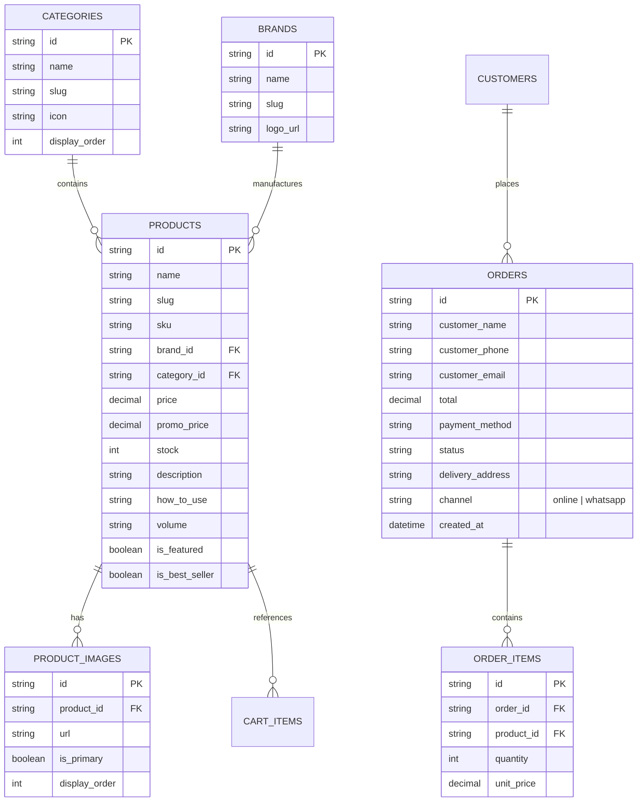

# Especificação Arquitetural: E-commerce Mariane Cosméticos

- **Data:** 05/11/2026
- **Status:** Identidade Confirmada em [`docs/DESIGN.md`](../DESIGN.md)
- **Marca:** Mariane Cosméticos (`@mariane_cosmeticos_01`) — Revendedora Oficial Madressenza
- **Slogan:** _"Linda é a mulher que bem se quer"_
- **WhatsApp Oficial:** `+55 (49) 99125-1617` (`5549991251617`)
- **Endereço:** `Rua Blumenau, Nº 623, Lages – SC (CEP: 88505-300)`
- **Diretório:** `C:\Users\ricop\Documents\Mariane Cosmeticos`
- **Alvo REA (Engenharia Reversa):** `https://www.lindacosmeticos.com.br/` (Magazord Platform)

---

## 1. Visão Geral do Produto

Construção de uma loja virtual e-commerce moderna, de alta performance e visual sofisticado (estilo Sephora / Salão de Beleza Premium), especializada em produtos de beleza, cuidados capilares profissionais e perfumaria.

O projeto combina:

1. **Vitrine Digital de Alta Conversão:** Catálogo categorizado com as marcas mais desejadas do mercado (_Wella, L'Oréal Professionnel, Truss, Braé, Lola Cosmetics, Amend_).
2. **Checkout Duplo (Omnichannel):**
   - **Checkout Online Integrado:** PIX e Cartão de Crédito.
   - **Checkout Direto via WhatsApp:** Botão de compra rápida com payload estruturado contendo itens, quantidades, valores e endereço para atendimento humanizado da Mariane no WhatsApp.
3. **Infraestrutura Cloudflare Edge First:**
   - **Next.js 15 (App Router)** + **Tailwind CSS**.
   - **Cloudflare D1** (banco de dados SQLite global na borda).
   - **Drizzle ORM** para contratos de schema tipados em TypeScript.

---

## 2. Resultados da Engenharia Reversa (REA Engine)

A partir da dissecação técnica do concorrente (`lindacosmeticos.com.br`), os seguintes artefatos foram coletados e analisados:

- **Plataforma Original:** Magazord E-commerce (CDN `zordcdn.com.br`).
- **Dimensão:** 8.865 produtos ativos mapeados e 248 categorias.
- **Formato dos Dados:** Schemas canônicos `application/ld+json` (`@type: Product`) contendo Nome, SKU, Marca, Preço Normal, Preço Promocional, Imagens em alta resolução e Breadcrumbs de navegação.
- **Estratégia de Carga (Seeder):** Script automatizado em Node/TypeScript que lê o sitemap da Linda Cosméticos, filtra 60 a 80 SKUs das principais marcas e popula diretamente as tabelas do Cloudflare D1.

---

## 3. Modelo de Dados (Cloudflare D1 via Drizzle ORM)



---

## 4. Design System & Identidade Visual (Contrato em [`docs/DESIGN.md`](../DESIGN.md))

- **Arquétipo Visual:** Beleza Profissional de Salão & Luxo Acessível Acolhedor (fiel à fachada física em Lages – SC).
- **Paleta de Cores Oficial (Decisão 3-A):**
  - Escala Roxo/Violeta Imperial (`marina-50..950`): Primária `#75066A` (`hsl(306, 90%, 24%)`), Vibrante `#9C27B0` (`hsl(291, 64%, 42%)`), Escuro `#4D0046` (`hsl(305, 100%, 15%)`).
  - Destaque/Acento: Magenta Imperial `#EB1E78` (`hsl(334, 84%, 52%)`).
  - Superfícies: Seda Off-White `#FAF7FB` / `#FAF7F7` e Preto Ônix `#1A0918`.
  - Conversão WhatsApp: Verde Esmeralda `#25D366` / `#128C7E`.
- **Tipografia:** Serifada clássica para títulos (_Playfair Display_) e sans-serif legível para corpo e preços (_Plus Jakarta Sans_) via `next/font/google`.
- **Componentes Centrais:**
  - Header fixo com busca rápida por marcas/linhas e badge de carrinho reativo.
  - Faixa superior de avisos: "Frete Grátis acima de R$ 199 | Compre pelo WhatsApp com Atendimento Personalizado".
  - Carrossel de Marcas Oficiais (Wella, Truss, Braé, L'Oréal, Lola).
  - Card de Produto com hover zoom, preço parcelado em até 10x sem juros e botões duplos ("Adicionar à Sacola" e "Comprar no WhatsApp").
  - Gaveta de Carrinho (Cart Drawer) com barra de progresso para Frete Grátis e seletor de finalização de pedido.

---

## 5. Arquitetura de Componentes e Pastas do Projeto

```
Mariane Cosmeticos/
├── .wrangler/                  # Cache local do Cloudflare D1
├── drizzle/                    # Migrações SQL versionadas para D1
├── src/
│   ├── app/                    # Next.js 15 App Router
│   │   ├── layout.tsx          # Layout global com Fontes, Header e Footer
│   │   ├── page.tsx            # Home com Vitrines, Banners e Marcas
│   │   ├── produtos/           # Listagem geral com filtros (marcas, faixas de preço)
│   │   ├── produto/[slug]/     # Página de Detalhe do Produto com galeria e modo de uso
│   │   ├── categoria/[slug]/   # Páginas por categoria (Cabelos, Tratamento, etc.)
│   │   ├── carrinho/           # Página de revisão da sacola
│   │   ├── checkout/           # Checkout direto online
│   │   └── api/                # Rotas de API internas
│   │       ├── produtos/       # Listagem e busca com paginação D1
│   │       ├── pedidos/        # Registro de pedidos e checkout WhatsApp
│   │       └── frete/          # Cálculo preliminar de frete (ViaCEP)
│   ├── components/             # Componentes de UI modulares
│   │   ├── Header.tsx
│   │   ├── Footer.tsx
│   │   ├── ProductCard.tsx
│   │   ├── CartDrawer.tsx
│   │   ├── WhatsAppButton.tsx
│   │   └── BrandShowcase.tsx
│   ├── db/                     # Camada de Dados
│   │   ├── index.ts            # Conexão Drizzle com D1
│   │   └── schema.ts           # Definição das tabelas em TypeScript
│   └── scripts/
│       └── seed-from-rea.ts    # Script de extração da Linda Cosméticos para o D1
├── drizzle.config.ts           # Configuração de migração Drizzle
├── wrangler.toml               # Configuração Cloudflare D1
├── package.json
└── tailwind.config.ts
```

---

## 6. Critérios de Aceite & Verificação

1. **Catálogo Alimentado:** D1 local populado com pelo menos 50 produtos reais completos das marcas selecionadas com imagens funcionando.
2. **Navegação Fluida:** Filtros por marca, categoria e busca instantânea sem recarregamento de página.
3. **Carrinho Reativo:** Adicionar/remover itens, atualizar quantidades e persistência de sacola em LocalStorage/Session.
4. **Checkout WhatsApp:** Mensagem pré-formatada contendo itens, SKUs, totais e dados de entrega enviada diretamente para o WhatsApp da Mariane Cosméticos.
5. **Zero Erros de Build:** Execução de `npm run build` ou `npx wrangler dev` com código 0 e sem falhas de tipagem.
